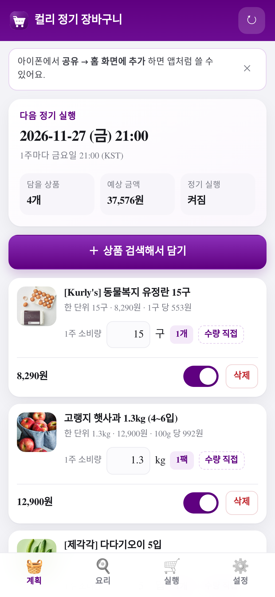
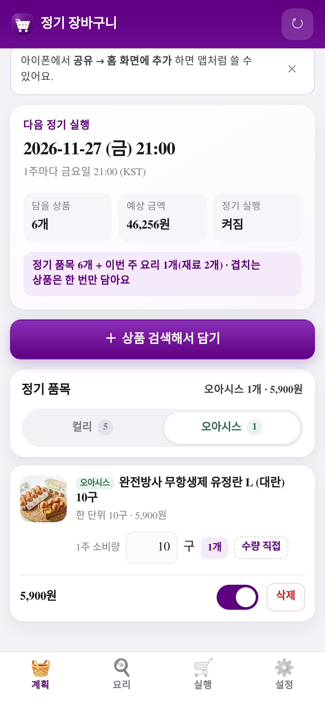
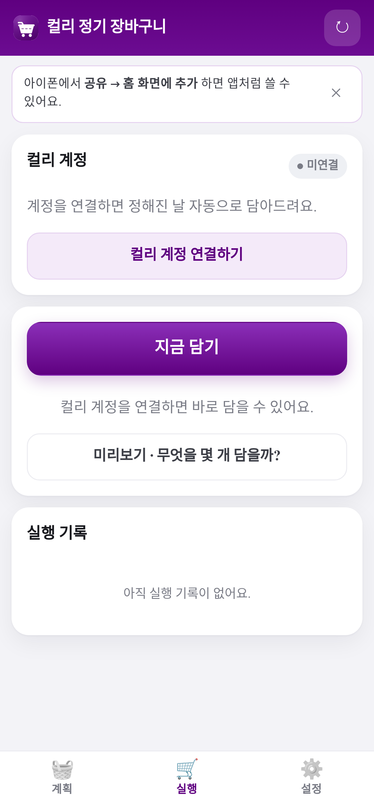
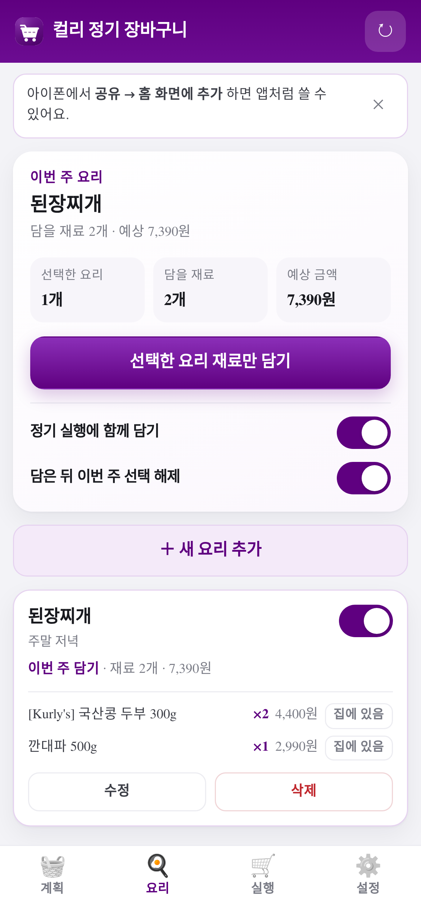
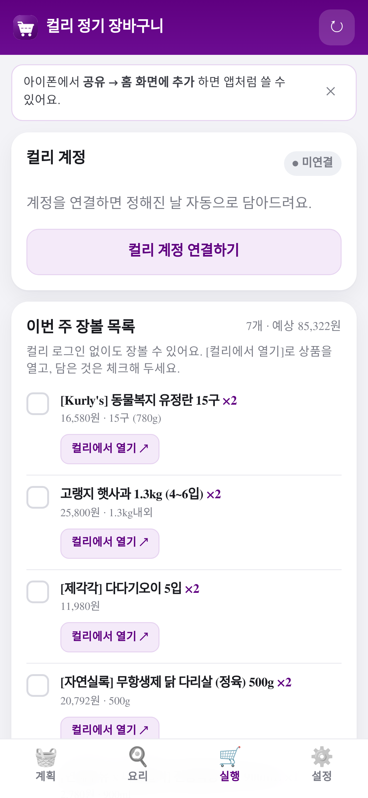
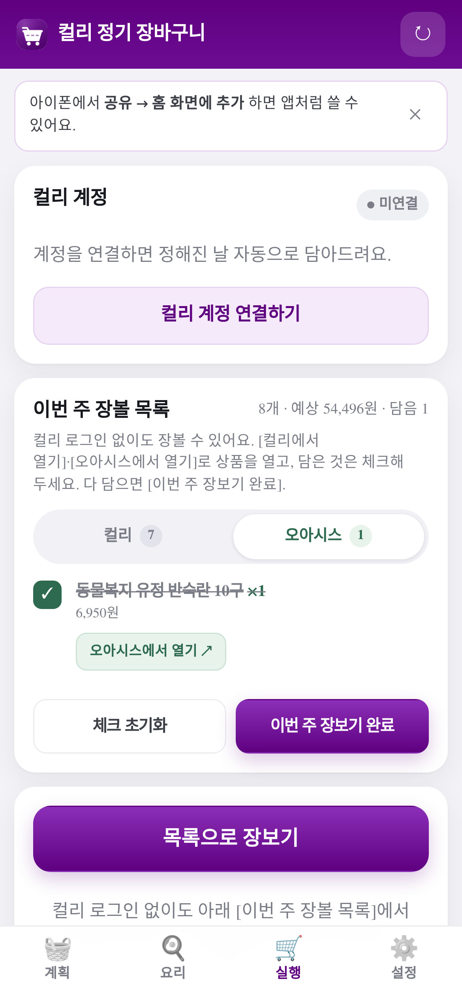
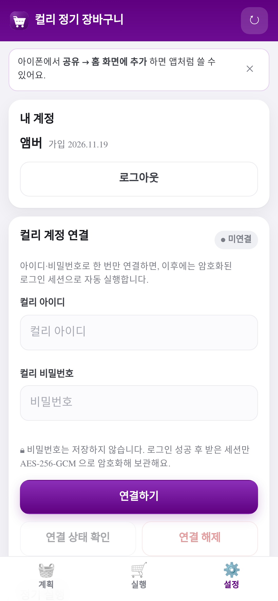

# 🛒 정기 장바구니 (kurly-auto-app)

[](https://github.com/yoonyoon0117-crypto/kurly-auto-app/actions/workflows/test.yml)
[](LICENSE)

마켓컬리에서 **설정한 주기(기본 1주)마다 정해진 요일·시각에, 그 주기 동안 먹을 양만큼만 장바구니에 담아주는** 웹 앱입니다.
이번 버전은 **여러 명(초대받은 지인)이 각자 계정으로 쓰는 PWA**이고, **도커로 작은 클라우드 서버에 올려
아이폰 "홈 화면에 추가"로 앱처럼** 쓸 수 있게 만든 버전입니다.
컬리 계정을 연결하면 정기 실행이 **자동으로 장바구니에 담고**, 연결하지 않아도 **이번 주 장볼 목록**으로 장볼 수 있습니다.
v2.3.0 부터 **오아시스마켓**도 같은 화면에서 검색해 목록에 담을 수 있습니다(로그인 연동 없이, 목록·바로 열기만).

> ⚠️ **담기만 합니다. 주문·결제는 절대 하지 않습니다.**
> 결제는 언제나 직접 컬리 앱/웹에서 장바구니를 확인하고 진행하세요.
>
> ⚠️ 컬리 웹 화면을 브라우저 자동화(Playwright)로 조작합니다. 컬리 공식 API 가 아니므로
> 화면이 바뀌면 선택자를 고쳐야 할 수 있고, 계정 이용 정책에 따라 제한될 수 있습니다.
> **본인 계정, 소규모 지인용**으로만 쓰세요.

---

## 화면 미리보기 (아이폰 390×844)









왼쪽부터 **계획 탭**(다음 정기 실행·예상 금액) · **계획 탭 마켓 선택**([컬리 | 오아시스] 와 마켓별 개수·금액) ·
**실행 탭**(이번 주 장볼 목록·지금 담기·실행 기록) · **요리 탭**(이번 주 요리·필수재료·집에 있음) ·
**장볼 목록**(마켓별 목록·담음 체크) · **오아시스 목록**(오아시스에서 열기·초록 배지) ·
**설정 탭**(주기·요일·시각, 컬리 계정 연결).
모두 테스트 계정(`앰버`)으로 찍은 화면입니다.

---

## 1. 이번 버전에서 달라진 점

이 저장소는 초대받은 지인들이 **각자 계정으로 쓰는 멀티유저 PWA(v2)** 입니다.
처음에 만든 1인용 버전(내 컴퓨터에서만 돌던 스크립트)과 비교하면 다음과 같습니다.

| | 1인용 버전(초기) | 이 버전(`kurly-auto-app` v2) |
|---|---|---|
| 사용자 | 1명 (내 컴퓨터) | 여러 명 (초대 코드 + 닉네임/비밀번호) |
| 데이터 | `config/cart-plan.json` 한 파일 | `DATA_DIR/users/{userId}.json` 사용자별 완전 분리 |
| 컬리 로그인 | 내 컴퓨터의 세션 파일 | 사용자마다 화면에서 연결 → 세션을 **AES-256-GCM** 으로 암호화해 보관 |
| 화면 | 데스크톱 웹 | **아이폰 우선 PWA** (홈 화면 추가, 오프라인 껍데기) |
| 정기 실행 | 내 PC에서 `npm run schedule` | 서버 안 **내장 스케줄러**(60초마다 점검, 동시 실행 1개 큐) |
| 배포 | 없음 | **Dockerfile + docker-compose** (Railway / Fly.io / Oracle Cloud) |
| 실행 기록·알림 | 파일 + 데스크톱 알림 | 사용자별 실행 기록 + **아이폰 홈 화면 앱 웹 푸시**(Web Push) + **Slack/Discord/ntfy 웹훅** |

**v2.1.0 (2026-11-19)** — 아이폰 홈 화면 앱 **자체 웹 푸시(Web Push + VAPID)** 추가.
ntfy·별도 앱 없이 담기 결과가 잠금화면 알림으로 오고, VAPID 키는 첫 실행 때 `DATA_DIR/vapid.json` 에 자동 생성됩니다.

**v2.1.1 (2026-11-19)** — 설정의 푸시 상태가 **'확인 중…' 에 멈추던 문제** 수정(서비스 워커 준비를 최대 3.5초만 기다리고, 상태는 먼저 그림),
서비스 워커 캐시를 **네트워크 우선**으로 바꿔 새로 배포한 화면·스크립트가 홈 화면 앱을 **한 번만 다시 열어도** 바로 반영됩니다.
같은 날, 아이폰 **테스트 알림이 오지 않던 문제**도 고쳤습니다 — 애플 푸시 서버가 VAPID `sub` 의 `example.invalid` 주소를 403 으로 거부하고 있었고,
이제 기본 주소를 https 주소로 바꾸며 **이미 만들어져 있던 `vapid.json` 의 sub 만 자동으로 교체**(키는 그대로)합니다. 실패 시에는 푸시 서버가 준 사유(`HTTP 403: …`)를 화면에 보여 줍니다.

**v2.2.0 (2026-11-20)** — **요리(메뉴) 탭** 추가. 좋아하는 요리에 필수재료를 등록해 두고
**"이번 주 담기"** 로 고르면 정기 장바구니에 함께 담깁니다. 같은 상품은 **한 줄로만** 담고 **수량을 더하지 않습니다**
(정기 품목에 있으면 정기 수량 그대로, 요리끼리 겹치면 큰 수량만). 함께 바뀐 것:
- **실패해도 반드시 푸시**: 성공·부분·실패·`NO_ITEMS`·`SESSION_EXPIRED`·`KURLY_NOT_CONNECTED` 모든 결과에 알림을 보내고,
  세션 만료는 제목부터 `⚠️ 컬리 로그인 만료 — 다시 연결해 주세요` 로 구분됩니다(탭하면 설정 화면).
- **실행 기록에 푸시 상태 표시**: `🔔 푸시 1대 전송됨` / `🔕 등록된 기기 없음` / `⚠️ 푸시 실패: HTTP 403…`.
- **컬리 세션 갱신 저장**: 실행 중 컬리가 갱신한 쿠키를 암호화해 다시 저장해, 다음 실행이 예전 토큰으로 실패하지 않습니다.
- **요리 담은 뒤 정리**: `담은 뒤 이번 주 선택 해제`(기본 켜짐)로 다음 주를 깨끗하게 시작합니다.
- **컬리 로그인 없이 장보기**: 실행 탭의 **이번 주 장볼 목록**에서 상품마다 `담음` 체크와 **`컬리에서 열기`**
  (컬리 상품 페이지) 버튼을 쓰고, **`이번 주 장보기 완료`** 로 체크와 요리 선택을 한 번에 정리합니다.
  설정의 **목록 알림만 받기** 를 켜면 정기 실행이 담는 대신 `🛒 이번 주 장볼 목록을 체크할 시간이에요` 푸시를 보냅니다.
  컬리가 연결돼 있지 않아도 이제 실패가 아니라 **목록 준비**로 처리됩니다.

**v2.2.1 (2026-11-20)** — **푸시가 안 올 때 스위치를 껐다 켜야 하던 문제** 수정.
앱은 이제 푸시 상태를 볼 때마다(그리고 테스트 알림을 보낼 때) 서버에 **이 기기 구독이 아직 등록돼 있는지**를 함께 확인하고,
서버가 새 `vapid.json` 키로 다시 만들어졌거나(볼륨 초기화·재배포) 구독이 옛 키로 남아 있으면 **조용히 다시 등록·재구독**합니다.
`GET /api/push/vapid-key?endpoint=…` 가 `{ enabled, publicKey, registered }` 를 돌려주고, 테스트 알림이 `0건`이면
한 번 자동으로 다시 연결해 재발송합니다. 서비스 워커 캐시는 `kurly-v2.2.1` 로 올렸습니다.

**v2.2.2 (2026-11-20)** — **기본 주기와 소비량 단위를 2주에서 1주로** 바꿨습니다.
새 계정의 정기 실행은 **1주마다(7일 간격)** 이고, 계획·추가 화면의 소비량 칸은 **`1주 소비량`** 처럼 지금 설정한 주기를 그대로 보여 줍니다
(2주·4주로 바꾸면 `2주 소비량`·`4주 소비량` 으로 함께 바뀝니다). 기본 4개 상품의 소비량도 1주 기준(1팩·1봉씩)으로 다시 잡았습니다.
주기는 그대로 **1~8주**까지 설정할 수 있습니다. 서비스 워커 캐시는 `kurly-v2.2.2` 로 올렸습니다.

**v2.3.0 (2026-11-22)** — **오아시스마켓 검색·장볼 목록 통합**. 컬리 로그인 연동 없이도 오아시스 상품을 검색해 담고,
**이번 주 장볼 목록**을 마켓별로 나눠 볼 수 있습니다.
- **검색의 `[컬리 | 오아시스]`**: 상품 검색과 요리 재료 검색 위에 마켓 전환 버튼을 두었습니다. 오아시스를 고르면
  검색창 안내 문구와 버튼 색이 **오아시스 초록(#2D6A4F)** 으로 바뀌고, 결과 카드마다 **컬리 / 오아시스 배지**가 붙습니다.
- **장볼 목록의 `[컬리 | 오아시스]`**: 목록 위에서 마켓을 고르면 그 마켓 상품만 보이고, 버튼 이름도
  **컬리 7 · 오아시스 1** 처럼 개수와 함께 표시됩니다. 오아시스 상품은 **[오아시스에서 열기 ↗]**(초록)로 바로 열립니다.
- **상품번호 충돌 방지**: 두 마켓의 상품번호는 서로 다른 체계라, 저장·체크를 `마켓:상품번호` 로 구분했습니다
  (컬리는 예전 저장값 그대로 읽습니다).
- **자동 담기는 컬리만**: 오아시스는 계정 연동을 하지 않으므로 정기 실행에서 **자동으로 담지 않습니다**.
  오아시스 상품은 장볼 목록에 남아 `[오아시스에서 열기]`로 직접 담고 `담음` 체크합니다.
  오아시스 상품만 있으면 브라우저를 열지 않고 목록만 준비해 알림합니다.
- 서비스 워커 캐시는 `kurly-v2.3.0` 으로 올렸습니다.

**v2.3.1 (2026-11-22)** — **계획 탭의 `[컬리 | 오아시스]` 전환**과 **앱 이름 정리**.
- **계획 탭 마켓 선택**: 정기 품목 위의 `[컬리 N | 오아시스 M]` pill 로 그 마켓 품목만 볼 수 있습니다.
  고른 마켓에 품목이 없으면 안내 문구를 보여 주고, **[＋ 상품 검색해서 담기]** 를 누르면 그 마켓이 선택된 채로 검색 화면이 열립니다.
  요약 카드의 **담을 상품 · 예상 금액은 두 마켓 전체** 합계이고, pill 옆 개수와 품목 위 한 줄(`컬리 5개 · 23,400원`)이 지금 보고 있는 마켓의 몫을 알려 줍니다.
- **앱 이름**: `컬리 정기 장바구니` → **`정기 장바구니`** (화면 제목·상단 바·홈 화면 이름·매니페스트·알림 기본 제목).
- 서비스 워커 캐시는 `kurly-v2.3.1` 로 올렸습니다.

**v2.3.2 (2026-11-22)** — **오아시스 상품을 오아시스 앱으로 열기**.
- **`[오아시스에서 열기 ↗]` 가 오아시스 앱을 엽니다**: 오아시스는 컬리처럼 유니버설 링크를 열어 주지 않아
  (`apple-app-site-association` 없음) 아이폰에서 상품 주소를 눌러도 사파리에 머물렀습니다.
  이제 휴대폰에서는 오아시스가 자기 앱 링크에 쓰는 `/appLink?r=...` 를 거쳐 **오아시스 앱**의 상품 화면이 열립니다
  (아이폰 `oasiskr://`, 안드로이드 `intent://`, 앱이 없으면 오아시스 안내 화면의 웹 이동 버튼).
- **PC 에서는 그대로**: 컴퓨터에서는 앱 링크가 의미 없으므로 상품 웹 페이지(`m.oasis.co.kr/product/detail/...`)로 엽니다.
- 품목 이름·계획 탭 링크는 그대로 **웹 상품 페이지**입니다.
- 서비스 워커 캐시는 `kurly-v2.3.2` 로 올렸습니다.

**v2.3.3 (2026-11-22)** — **아이폰에서 App Store 가 같이 열리던 문제 수정**.
- **원인**: v2.3.2 가 거치던 `/appLink` 안내 화면은 사파리에서 **5초 뒤 무조건 App Store 로 넘어갑니다**
  (앱이 열려도 `onblur` 판정이 늦으면 그대로 실행). 그래서 오아시스 앱과 App Store 가 함께 열렸습니다.
- **수정**: 아이폰에서는 그 화면을 거치지 않고, 그 화면이 앱에 넘기는 딥링크를 **바로** 씁니다.
  `oasiskr://deeplink?menu=page&nextUrl={상품 경로}&loginyn=N&data=`
- **빈 탭 방지**: `oasiskr://` 링크에는 `target="_blank"`·`rel` 을 붙이지 않습니다(홈 화면 앱·사파리에서 빈 탭이 열리지 않도록).
- 안드로이드는 그대로 `/appLink?r=...`, PC 는 상품 웹 페이지 그대로입니다.
- 서비스 워커 캐시는 `kurly-v2.3.3` 으로 올렸습니다.

**v2.3.4 (2026-11-22)** — **오아시스 앱이 앞서 연 상품에 머물던 문제 수정**.
- **증상**: 유정란을 담아 열고, 이어서 사과의 `[오아시스에서 열기]`를 누르면 **유정란이 그대로** 열렸습니다.
- **원인**: 오아시스는 자기 앱 링크에서 매번 새 7자리 `v=` 값을 붙입니다
  (`oasiskr://deeplink?menu=page&nextUrl=…&loginyn=N&v=9162543&data=`).
  v2.3.3 은 이 값을 빼고 보내서, **앱이 이미 열려 있을 때 같은 주소로 판단해 새 화면으로 넘어가지 않았습니다**.
- **수정**: `v=` 에 **누를 때마다 새 7자리 숫자**를 넣습니다(`oasisDeeplinkVersion`).
  목록을 다시 그리지 않고 같은 버튼을 두 번 누르거나, 앞서 연 상품이 앱에 남아 있어도
  **손가락이 닿는 순간(pointerdown·touchstart·click) 주소의 `v=` 를 새로 만들어** 그 상품으로 이동합니다.
- 서비스 워커 캐시는 `kurly-v2.3.4` 로 올렸습니다.

**v2.3.5 (2026-11-22)** — **기본 상품에 오아시스 4개 추가**. 새로 가입하거나 [기본 상품 불러오기]를 누르면
**컬리 4개 + 오아시스 4개, 모두 8개**가 담깁니다.
- **추가된 오아시스 상품**(2026-11-22 오아시스에서 확인): 완전방사 무항생제 유정란 L (20구.대란) 11,600원 ·
  GAP 부사사과 1.3kg(5-7입) 11,800원 · [농할20%쿠폰]백오이(2입,330g내외) / 무농약 4,620원 ·
  무항생제 자연실록 정육(닭다리살) (350g) 6,950원. 합계 34,970원(1주 1팩·1봉씩).
  컬리 4개(37,576원)까지 **8개 합계 72,546원**입니다.
- **마켓별로 보입니다**: 계획 탭의 `[컬리 4 | 오아시스 4]` pill 로 나눠 보고, 오아시스 4개는 자동 담기 대신
  장볼 목록에서 `[오아시스에서 열기]`로 직접 담습니다. 이미 계획을 저장한 계정은 그대로 두고,
  [기본 상품 불러오기]를 누를 때만 빠진 상품이 채워집니다(마켓:상품번호로 중복 확인).
- 서비스 워커 캐시는 `kurly-v2.3.5` 로 올렸습니다.

**v2.3.6 (2026-11-22)** — **홈 화면 아이콘을 파스텔 민트 새싹 바구니 + 시계 배지로 교체**. v2.3.0 의 보라색 장바구니 아이콘 대신,
크림색 파스텔 바구니에 민트 새싹·과일과 **시계 배지**(정기 실행)를 얹은 그림을 홈 화면 아이콘으로 씁니다.
- 바뀐 파일: `public/icons/icon-192.png` · `icon-512.png` · `maskable-512.png` · `apple-touch-icon.png`(180×180, 투명도 없는 RGB — 아이폰이 투명 영역을 검정으로 칠하지 않도록).
- 매니페스트·`index.html` 의 아이콘 경로와 크기는 그대로라 두 파일은 손대지 않았습니다. 다만 **아이폰은 홈 화면 아이콘 그림을 한 번 정해지면 캐시**하므로, 이미 추가해 둔 앱은 **홈 화면에서 지웠다가 다시 추가**해야 새 그림으로 바뀝니다(계정·계획은 서버에 있어 그대로입니다). 안드로이드·데스크톱은 다음 방문 때 캐시가 갱신됩니다.
- 화면 테마 색(`#5F0080` 보라 헤더)은 그대로입니다.
- 서비스 워커 캐시는 `kurly-v2.3.6` 로 올렸습니다.

**v2.3.7 (2026-11-22)** — **홈 화면 아이콘 배경을 연보라로 교체**. v2.3.6 의 파스텔 민트 배경 아이콘과 같은
바구니·새싹·과일·시계 배지 그림에 **연보라(라일락) 배경**을 입힌 이미지를 씁니다. 그림 자체와 아이콘 경로·크기는 그대로입니다.
- 바뀐 파일: `public/icons/icon-192.png` · `icon-512.png` · `maskable-512.png` · `apple-touch-icon.png`(180×180, 투명도 없는 RGB — 아이폰이 투명 영역을 검정으로 칠하지 않도록). 원본 PNG 를 PIL LANCZOS 로 각 크기에 맞춰 줄였습니다.
- 매니페스트·`index.html` 의 아이콘 경로·크기와 화면 테마 색(`#5F0080`)은 그대로라 두 파일은 손대지 않았습니다. **아이폰은 홈 화면 아이콘 그림을 한 번 정해지면 캐시**하므로, 이미 추가해 둔 앱은 **홈 화면에서 지웠다가 다시 추가**해야 연보라 아이콘으로 바뀝니다(계정·계획은 서버에 있어 그대로입니다). 안드로이드·데스크톱은 다음 방문 때 갱신됩니다.
- 서비스 워커 캐시는 `kurly-v2.3.7` 로 올렸습니다.

**v2.3.8 (2026-11-22)** — **아이폰 "홈 화면에 추가" 할 때 뜨는 이름을 `Cart helper🤍` 로 변경**. Safari 공유 → 홈 화면에 추가 화면의 기본 이름과,
홈 화면 아이콘 아래 이름이 `Cart helper🤍` 로 나옵니다.
- 바뀐 파일: `public/index.html` 의 `<meta name="apple-mobile-web-app-title">`, `public/manifest.json` 의 `name`·`short_name`(둘 다 `Cart helper🤍`).
- **화면 안의 이름은 그대로**입니다 — 앱 상단 바·브라우저 탭 제목(`<title>`)·알림 기본 제목은 `정기 장바구니` 를 씁니다.
- **로그인 화면 부제에서 마켓 이름을 뺐습니다**: `1주에 한 번, 먹을 만큼만 마켓컬리 장바구니에 담아둘게요.` → `1주에 한 번, 먹을 만큼만 장바구니에 담아둘게요.`
  (오아시스 목록도 쓰는 화면이라 특정 마켓 이름 없이 적었습니다. `public/index.html` 의 `.auth-brand` 문장만 바뀌고 다른 화면 문구는 그대로입니다.)
  이미 홈 화면에 추가해 둔 앱은 **지웠다가 다시 추가**해야 이름이 바뀝니다(아이폰은 추가할 때의 이름을 그대로 기억합니다. 계정·계획은 서버에 있어 그대로입니다).
- 서비스 워커 캐시는 `kurly-v2.3.8` 로 올렸습니다.

**v2.2.3 (2026-11-20)** — **알림 문구 정리**. 목록 알림 제목을 `🛒 이번 주 장볼 목록을 체크할 시간이에요` 로 바꿔
잠금화면에서 무엇을 하면 되는지 한 줄로 보이게 했고, 설정의 푸시 상태 문구도 `켜짐 — 이 기기 알림으로 보내드려요.` 로 줄였습니다.
서비스 워커 캐시는 `kurly-v2.2.3` 로 올려 홈 화면 앱이 새 문구를 바로 받도록 했습니다.

---

## 2. 5분 안에 로컬에서 실행

준비물: **Node.js 20 이상**, 인터넷.

```bash
cd kurly-auto-app
npm install
cp .env.example .env

# .env 를 열어 두 값을 꼭 바꾸세요
#   INVITE_CODE = 지인에게 알려줄 초대 코드 (예: kurly-2026)
#   APP_SECRET  = 세션·암호화 키, 16자 이상 (예: openssl rand -hex 32)

npx playwright install chromium   # 처음 한 번만 (약 150MB)
npm start
```

→ 브라우저에서 **http://localhost:3000** 접속 → 회원가입(초대 코드) → 사용.

> 로컬(`localhost`)은 HTTPS 없이도 동작합니다. 휴대폰에서 접속하려면 같은 Wi‑Fi 에서
> `http://내PC아이피:3000` 으로 열 수 있지만, **홈 화면 추가(standalone)와 서비스 워커는 HTTPS 에서만** 동작합니다.
> 아이폰에서 진짜 앱처럼 쓰려면 아래 7~8장(도커·클라우드)처럼 HTTPS 주소로 올리세요.

---

## 3. 사용 흐름 (아이폰 기준)

1. **회원가입** — 초대 코드 + 닉네임 + 비밀번호(6자 이상).
   가입할 때 **"기본 8개 상품으로 시작하기"** 를 체크하면 **컬리 4개 + 오아시스 4개**가 바로 담깁니다.
   | 마켓 | 상품 | 상품번호 | 한 단위 | 1주 소비량 | 담을 수량 | 가격 |
   |---|---|---|---|---|---|---|
   | 컬리 | [Kurly's] 동물복지 유정란 15구 | 5029849 | 15구 | 15구 | 1팩 | 8,290원 |
   | 컬리 | 고랭지 햇사과 1.3kg (4~6입) | 5061259 | 1.3kg | 1.3kg | 1봉 | 12,900원 |
   | 컬리 | [제각각] 다다기오이 5입 | 1002030322 | 5입 | 5입 | 1봉 | 5,990원 |
   | 컬리 | [자연실록] 무항생제 닭 다리살 500g | 5090273 | 500g | 500g | 1팩 | 10,396원 |
   | 오아시스 | 완전방사 무항생제 유정란 L (20구.대란) | 105322 | 20구 | 20구 | 1판 | 11,600원 |
   | 오아시스 | GAP 부사사과 1.3kg(5-7입) | 98649 | 1.3kg | 1.3kg | 1봉 | 11,800원 |
   | 오아시스 | [농할20%쿠폰]백오이(2입,330g내외) / 무농약 | 74079 | 2입 | 2입 | 1봉 | 4,620원 |
   | 오아시스 | 무항생제 자연실록 정육(닭다리살) (350g) | 1116 | 350g | 350g | 1팩 | 6,950원 |
   합계 예상 **72,546원**(컬리 37,576원 + 오아시스 34,970원). 가격·재고는 마켓에서 수시로 바뀝니다.
   컬리 상품은 정기 실행에 자동으로 담기고, 오아시스 상품은 장볼 목록에서 직접 담습니다.
   비워두고 직접 검색해 담아도 됩니다.
2. **계획 탭** — 상품 검색(마켓 전환 `[컬리 | 오아시스]`, 실제 검색) → `+ 추가` → 한 단위 크기와 **소비량**(설정한 주기 동안 먹는 양, 기본 **1주 소비량**) 입력.
   `담을 수량 = 올림(소비량 ÷ 한 단위)` 로 자동 계산됩니다. 수량을 직접 정하고 싶으면 `수량 직접`.
3. **설정 탭 → 컬리 계정 연결** — 컬리 아이디·비밀번호로 **한 번만** 연결.
   클라우드 서버에서 로그인이 차단되면 **컴퓨터 브라우저(크롬·엣지)** 에서 로그인한 세션을 복사해
   아래 **세션 직접 가져오기**로 연결하세요. (아이폰 사파리·컬리 앱에서는 세션을 복사할 수 없습니다.)
4. **설정 탭 → 정기 실행** — 주기(기본 **1주**, 1~8주 설정 가능)·요일(기본 금요일)·시각(기본 21:00)·기준일(첫 실행일).
5. **알림(선택)** — **이 기기 푸시 알림**을 켜면 담기 결과가 아이폰 잠금화면 알림으로 옵니다(앱 설치·ntfy 불필요).
   Slack / Discord / ntfy 웹훅 주소를 넣으면 그쪽으로도 같이 보냅니다.
6. **실행 탭 → 지금 담기** 로 미리 연습 → 컬리 앱에서 장바구니 확인 → 직접 결제.
7. **아이폰 홈 화면 추가** — Safari 로 접속 → 공유(⬆️) → **홈 화면에 추가**.
   이후에는 주소창 없는 전체 화면 앱으로 열립니다.

### 3-1. 요리 탭 — 좋아하는 메뉴의 필수재료를 한 번에 담기

`계획` 탭의 소비량(기본 1주 소비량)과 별개로, **요리(메뉴)마다 필수재료**를 등록해 두는 탭입니다.

1. **요리 탭 → ＋ 새 요리 추가** — 요리 이름(예: `된장찌개`), 메모(선택)를 적고
   같은 화면의 **재료 검색**에서 실제 컬리 상품을 찾아 `재료로 추가` 합니다. 재료마다 `+ / −` 로 수량을 정합니다.
2. 카드에서 **이번 주 담기** 스위치를 켜면 다음 실행에 그 요리 재료가 함께 담깁니다.
   이번 주만 빼고 싶은 재료는 `집에 있음` 을 눌러 **이번 주 제외**(다음 주에 자동 복귀)로 둡니다.
3. **선택한 요리 재료만 담기** — 정기 품목 없이, 고른 요리 재료만 지금 담습니다. (컬리가 연결되지 않았으면 실행 탭의 장볼 목록으로 안내합니다.)
4. **정기 실행에 함께 담기** (기본 켜짐) — 정기 실행(기본 1주마다)에 정기 품목 + 이번 주 요리를 함께 담습니다.
   **담은 뒤 이번 주 선택 해제** (기본 켜짐) — 한 번 담으면 선택이 풀려 다음 주를 깨끗하게 시작합니다.

**같은 상품은 한 줄로만 담고, 수량을 더하지 않습니다.**

| 상황 | 담기는 수량 |
|---|---|
| 정기 품목 `계란 2팩` + 요리 `계란 1팩` | **2팩** (정기 품목 수량 그대로) |
| 요리 A `대파 1` + 요리 B `대파 3` | **3** (둘 중 큰 수량) |
| 이번 주 제외(`집에 있음`) 재료 | 담지 않음 |

그래서 요리를 여러 개 골라도 같은 재료가 두 배로 주문되지 않습니다.
계획·실행 화면에는 `정기 품목 4개 + 이번 주 요리 2개(재료 5개) · 겹치는 상품은 한 번만 담아요` 처럼 표시됩니다.

### 3-2. 컬리 로그인 없이 — 이번 주 장볼 목록

컬리 세션이 만료됐거나, 아예 연결하고 싶지 않을 때도 앱을 쓸 수 있습니다.

1. **실행 탭 → 이번 주 장볼 목록** — 정기 품목 + 이번 주 요리가 위와 **같은 규칙**으로 한 줄씩 나옵니다.
   줄마다 **`담음` 체크**(사용자별로 저장)와 **`컬리에서 열기 ↗`**(`https://www.kurly.com/goods/{상품번호}`, 새 탭)가 있습니다.
2. 컬리 앱/웹에서 상품을 담고 돌아와 **`담음`** 을 눌러 지워 갑니다. **`체크 초기화`** 로 한 번에 비울 수도 있습니다.
3. 다 담았으면 **`이번 주 장보기 완료`** — 담음 체크를 비우고, `담은 뒤 이번 주 선택 해제` 가 켜져 있으면
   **이번 주 요리 선택과 `집에 있음` 제외까지** 함께 풀어 다음 주를 깨끗하게 시작합니다.
4. **설정 → 알림 → 컬리 로그인 없이 목록 알림만 받기** 를 켜면, 정기 실행이 장바구니에 담는 대신
   **`🛒 이번 주 장볼 목록을 체크할 시간이에요`** 푸시를 보냅니다. 알림을 누르면 `/#run` 의 목록이 열립니다.
   (컬리가 연결돼 있지 않아도 자동으로 이 방식으로 동작합니다 — 실패 알림·재연결 요구가 아닙니다.)

> 정기 실행의 목록 알림은 **목록만 준비**합니다. 요리 선택은 장보기를 마치고 `이번 주 장보기 완료` 를 눌렀을 때 풀립니다.
> 컬리가 **연결돼 있었는데 만료**된 경우만 `⚠️ 컬리 로그인 만료 — 아래 목록에서 [컬리에서 열기]로 담을 수 있어요` 로 알립니다.

### 3-3. 오아시스마켓 — 로그인 연동 없이 같은 방식으로

"장바구니에 넣을 품목만 정리해서 연결해 주는 것"이라면 다른 마켓도 같은 방식으로 쓸 수 있습니다.
v2.3.0 부터 **오아시스마켓**을 같은 화면에서 함께 다룹니다. **오아시스 계정 연동은 하지 않습니다** —
검색해서 목록에 담고, `[오아시스에서 열기]`로 직접 담는 방식입니다.

1. **상품 검색 시트 위의 `[컬리 | 오아시스]`** — 오아시스를 고르면 검색 버튼이 **초록(#2D6A4F)** 으로 바뀌고
   실제 오아시스 검색 결과(가격·할인·품절·한 줄 설명)가 나옵니다. 결과 카드의 **`+ 추가`** 로 계획에 담습니다.
   요리 편집의 **재료 검색**에도 같은 전환 버튼이 있습니다(재료마다 마켓이 따로 기억됩니다).
2. **계획·요리 화면** — 각 상품/재료에 **컬리 / 오아시스 배지**가 붙어 어느 마켓 상품인지 바로 보입니다.
3. **실행 탭 → 이번 주 장볼 목록** — 목록 위의 `[컬리 | 오아시스]` 로 마켓을 고르면 그 마켓 상품만 보입니다
   (버튼에 **개수**가 함께 표시: `컬리 7` `오아시스 1`). 오아시스 상품은 **[오아시스에서 열기 ↗]**(초록)로
   `https://m.oasis.co.kr/product/detail/{상품번호}` 를 엽니다. 그 마켓에 상품이 없으면
   `오아시스 상품이 아직 없어요` 처럼 안내합니다.
4. **자동 담기는 컬리 상품만** — 정기 실행·[지금 담기]는 컬리 상품만 브라우저로 담고, 오아시스 상품은
   실행 기록에 `⏭ 오아시스 상품 — 실행 탭 장볼 목록에서 직접 담아 주세요` 로 남깁니다.
   **오아시스 상품만 있으면** 브라우저를 열지 않고 장볼 목록만 준비해 알림합니다(실패 아님).

> 상품번호는 마켓마다 다른 체계라 `마켓:상품번호` 로 저장합니다. 컬리는 예전에 저장한 값(`상품번호`만)을
> 그대로 읽으므로, 이미 쓰던 계획·체크가 바뀌지 않습니다.
> 오아시스 검색은 `https://m.oasis.co.kr/product/search?keyword=…` 의 **HTML 을 읽어** 파싱합니다(공식 API 아님).
> 사이트 구조가 바뀌면 `lib/oasis-api.js` 의 파서를 손봐야 하고, 실제 페이지로 확인하며 관리하세요.

---

## 4. 수량 계산 규칙

```
담을 수량 = ceil(소비량(설정한 주기 동안 먹는 양) ÷ 한 단위 크기)     (최소 1, 최대 99)
```

| 예시 | 계산 | 결과 |
|---|---|---|
| 계란 15구, 1주에 30구 | 30 ÷ 15 = 2 | 2팩 |
| 사과 1.3kg, 1주에 2.6kg | 2.6 ÷ 1.3 = 2 | 2봉 |
| 닭다리 500g, 1주에 700g | 1.4 → 올림 | 2팩 |

- 상품마다 단위를 하나 고릅니다(예: `g`, `kg`, `구`, `입`, `ml`, `개`).
- **포함** 토글을 끄면 그 상품은 자동 실행에서 빠집니다.
- 옵션이 여러 개인 상품은 추가할 때 옵션을 고르고, 그 옵션으로 담습니다.

---

## 5. 정기 실행 방식 (기본 1주 주기)

- **기준일(anchorDate)부터 정확히 주기(기본 7일) 간격**입니다. "매월 1·3주 금요일" 같은 달력 규칙이 아니라
  정한 주기(1~8주)가 계속 유지됩니다.
- 서버 안 스케줄러가 **60초마다** 사용자별로 실행 시점인지 확인합니다.
- 실행 시각이 지난 뒤 **6시간 안**(`RUN_GRACE_HOURS`)이면 따라잡습니다. 서버가 잠깐 재시작돼도 놓치지 않습니다.
- **멱등성**: 슬롯마다 `기준일#회차` 키를 사용자 파일에 먼저 적고 큐에 넣습니다.
  같은 슬롯에서는 서버가 재시작되거나 점검이 겹쳐도 **한 번만** 담습니다.
- **동시 실행 1개**: 어떤 사용자의 작업이든 큐에 줄을 서서 하나씩 실행합니다.
  512MB~1GB 컨테이너에서 Chromium 이 여러 개 떠 OOM 나는 것을 막기 위해서입니다.
- 서버가 꺼져 있으면 실행되지 않습니다 → **항상 켜져 있는 클라우드 서버**에 올리세요(7~8장).
- 예약만 되고 실행 기록이 없으면(큐를 처리하기 전에 서버가 재시작된 경우) 다음 점검에서 **자동으로 다시 예약**합니다.

---

## 6. 컬리 계정 연결의 원리와 한계

1. 설정 탭에서 컬리 아이디·비밀번호를 입력하면 서버가 Playwright 로 컬리 로그인을 시도합니다.
2. 로그인에 성공하면 브라우저의 **로그인 세션(storageState: 쿠키·로컬스토리지)** 만 받아
   **AES-256-GCM**(키는 `APP_SECRET` 에서 유도)으로 암호화해 그 사용자 파일에 저장합니다.
3. **비밀번호는 저장하지 않습니다.** 저장 직후 메모리에서도 버립니다.
4. 이후 자동 실행은 이 세션으로 로그인 화면을 건너뜁니다.

한계와 주의:

- **세션은 몇 주 지나면 만료됩니다.** 그러면 실행 탭 배지가 `만료됨` 으로 바뀌고 실행 결과에
  "다시 연결해 주세요"가 남습니다. 설정에서 다시 연결하면 됩니다.
- **카카오·네이버 간편로그인만 쓰는 계정**은 아이디·비밀번호가 없어 이 방식으로 연결할 수 없습니다.
  컬리에 아이디/비밀번호 로그인을 함께 설정해 두어야 합니다.
- **해외·클라우드 서버 IP에서는 컬리의 봇 차단에 걸려, 비밀번호가 맞아도 "아이디 또는 비밀번호를 확인해주세요"(HTTP 422 · S001)로 거절될 수 있습니다.**
  2026-11-19 실제 확인: 로그인 화면에는 구글 reCAPTCHA Enterprise(보이지 않는 방식)가 붙어 있고, 로그인 응답에도 `isCaptchaRequired: true`가 함께 옵니다.
  이때 앱은 일반 문구 대신 **컬리가 실제로 돌려준 HTTP 상태·errorCode·안내 문구**를 설정 화면과 알림에 그대로 표시합니다(예: `컬리가 로그인을 거부했습니다 — "아이디 또는 비밀번호를 확인해주세요." (HTTP 422 · S001)`).
- **로그인 시 보안문자·추가 인증**이 뜨면 자동 로그인이 실패할 수 있습니다. 잠시 후 다시 시도하거나,
  컬리 앱에서 로그인 확인 후 다시 연결해 보세요.
- **세션 직접 가져오기 (reCAPTCHA 우회)** — 설정 탭의 `컬리 계정 연결` 아래 접이식 항목에서,
  **컴퓨터 브라우저(크롬·엣지)** 에서 컬리에 로그인한 세션을 그대로 붙여넣거나 파일로 올려 연결할 수 있습니다.
  - **휴대폰(아이폰 사파리·컬리 앱)에서는 세션을 복사할 수 없습니다.** iOS 사파리에는 개발자도구 Network 탭이 없고,
    컬리 앱은 쿠키를 내보낼 수 없습니다. 반드시 컴퓨터 브라우저에서 복사해 오세요(복사한 값은 휴대폰에서 이 앱 입력 칸에 붙여넣으면 됩니다).
  - **Cookie 헤더**: 컴퓨터 브라우저에서 컬리에 로그인 → 개발자도구(F12 또는 ⌥⌘I) **Network** 탭 → 요청 하나 선택 →
    **Request Headers** 의 `cookie:` 줄 전체를 복사해 붙여넣기. (여러 줄 헤더 블록을 통째로 붙여도 `cookie:` 줄만 읽습니다)
  - **storageState JSON**: 로컬 `kurly-auto-cart` 의 `.state/kurly-storage.json` 또는 Playwright 로 저장한
    `storage-state.json` 을 업로드. 형식: `{ "cookies": [...], "origins": [...] }`
  - 컬리 로그인 세션은 **HttpOnly 쿠키(ksi·krt)** 에 들어 있습니다(2026-11-19 실측: `Set-Cookie` … `Domain=kurly.com; Secure; HttpOnly; SameSite=None`).
    그래서 주소창의 `document.cookie` 로는 복사할 수 없고, 빠진 채 붙여넣으면 앱이 경고를 보여줍니다.
  - 가져온 세션도 **검증 후** 연결되며, 성공하면 브라우저가 갱신한 쿠키까지 다시 암호화해 보관합니다.
    실패하면 `유효한 컬리 로그인 세션을 확인하지 못했습니다. 로그인된 상태에서 다시 복사해 주세요.` 가 표시됩니다.
  - 주소창의 `document.cookie` 값에는 분석용 쿠키만 남으므로, 로그인 세션을 옮기려면 반드시 위 두 방법을 쓰세요.
- `APP_SECRET` 을 바꾸면 **모든 로그인 세션과 저장된 컬리 세션이 무효**가 됩니다(다시 연결 필요).
- 실행 중 로그인이 풀리면 그 실행은 중단되고 나머지 상품은 `건너뜀` 으로 기록됩니다.
- 한 번 실행할 때 상품마다 상품 페이지를 열어 옵션·수량을 고르고 담습니다(상품 4개면 1~2분).

---

## 7. Docker 로 실행

```bash
cd kurly-auto-app
cp .env.example .env      # INVITE_CODE, APP_SECRET 채우기
docker compose up -d --build
docker compose logs -f    # 로그 보기 (Ctrl+C 로 빠져나옴)
```

- 접속: **http://서버주소:3000**
- 사용자 데이터는 `./data` 볼륨에 남습니다. 컨테이너를 새로 만들어도 유지됩니다.
- 이미지: `mcr.microsoft.com/playwright:v1.65.1-jammy` (amd64·arm64 모두 지원, Chromium 포함)

자주 쓰는 명령:

```bash
docker compose ps                  # 상태
docker compose restart             # 재시작
docker compose down                # 중지 (데이터는 유지)
docker compose up -d --build       # 코드 수정 후 재빌드
docker compose exec kurly-auto-app npm test    # 컨테이너 안에서 테스트
```

**백업**: `data/` 폴더와 `.env` 의 `APP_SECRET` 을 함께 보관하세요.
`APP_SECRET` 이 없으면 백업한 컬리 세션을 복호화할 수 없습니다.

**업데이트**: 코드를 바꾼 뒤 `docker compose up -d --build`. `data/` 는 그대로입니다.

---

## 8. 클라우드 배포

### 8-1. Railway (가장 쉬움)

1. 이 폴더를 GitHub 저장소에 올립니다(`data/`, `.env` 는 `.gitignore` 로 제외됨).
2. [railway.app](https://railway.app) → **New Project → Deploy from GitHub repo** → 저장소 선택.
   Dockerfile 을 자동으로 인식합니다.
3. **Variables** 에 추가:
   - `INVITE_CODE` = 원하는 초대 코드
   - `APP_SECRET` = `openssl rand -hex 32` 결과
   - `DATA_DIR` = `/data`
   - (`PORT` 는 Railway 가 자동으로 넣어주며 앱이 그 값을 따릅니다)
4. **Volumes → Add Volume**, mount path **`/data`** (1GB면 충분).
5. **Settings → Networking → Generate Domain** → 나온 `https://...up.railway.app` 주소로 접속.
6. 아이폰 Safari 로 열고 **홈 화면에 추가**.

> 재배포해도 볼륨(`/data`)은 유지됩니다. 단, 볼륨을 지우면 사용자·컬리 연결이 모두 사라집니다.
> **웹 푸시는 추가 설정이 필요 없습니다.** 처음 켜질 때 `/data/vapid.json` 에 VAPID 키를 만들어 두고 계속 씁니다.
> (`VAPID_PUBLIC_KEY`/`VAPID_PRIVATE_KEY` 를 직접 넣어도 되지만, 볼륨을 백업하면 그대로 살아납니다.)

### 8-2. Fly.io

```bash
fly auth login
cd kurly-auto-app
fly launch --no-deploy        # Dockerfile 감지, 앱 이름·지역(예: nrt) 선택
fly volumes create kurly_data --size 1 --region nrt
fly secrets set INVITE_CODE=내초대코드 APP_SECRET=$(openssl rand -hex 32)
fly deploy
```

`fly.toml` 은 아래처럼 맞춰 주세요(특히 **auto_stop_machines = false**, **머신 1대**):

```toml
app = "내-앱-이름"
primary_region = "nrt"

[build]

[http_service]
  internal_port = 3000
  force_https = true
  auto_stop_machines = false     # 정기 실행 시각에 서버가 잠들면 안 됩니다
  auto_start_machines = true
  min_machines_running = 1

[[vm]]
  memory = "1gb"
  cpu_kind = "shared"
  cpus = 1

[mounts]
  source = "kurly_data"
  destination = "/data"
```

- `auto_stop_machines = true` 면 트래픽이 없을 때 머신이 꺼져 **정기 실행을 놓칩니다.**
- 머신을 2대 이상으로 늘리면 스케줄러가 중복 실행될 수 있습니다. **1대**로 두세요.
- 주소: `https://내-앱-이름.fly.dev`

### 8-3. Oracle Cloud Always Free

1. **인스턴스 만들기**: Compute → Instance.
   - 이미지: Ubuntu 22.04 (또는 24.04)
   - Shape: **VM.Standard.A1.Flex (Ampere, arm64)** — Always Free 로 4 OCPU/24GB 가능. **권장**
     (AMD `VM.Standard.E2.1.Micro` 1GB 는 Chromium 에 빠듯합니다.)
2. SSH 접속 후 Docker 설치:

```bash
sudo apt update
sudo apt install -y docker.io docker-compose-v2
sudo usermod -aG docker $USER
# 다시 로그인(또는 newgrp docker)
```

3. 앱 올리기 (git 또는 scp):

```bash
git clone <내-저장소> kurly-auto-app && cd kurly-auto-app
cp .env.example .env
nano .env            # INVITE_CODE, APP_SECRET
docker compose up -d --build
```

4. **포트 열기**
   - Oracle 콘솔: VCN → Security Lists → Default Security List → **Ingress Rule 추가**
     `0.0.0.0/0`, TCP, 목적지 포트 `80,443` (테스트용으로 `3000` 도)
   - Ubuntu 방화벽을 켰다면: `sudo ufw allow 80,443/tcp`

5. **HTTPS (아이폰 PWA·보안 쿠키에 필수)** — 무료 도메인(DuckDNS 등) + Caddy:

```bash
# DuckDNS 에서 서브도메인 발급 후 공인 IP 등록 (예: mykurly.duckdns.org)
sudo apt install -y caddy
sudo tee /etc/caddy/Caddyfile >/dev/null <<'EOF'
mykurly.duckdns.org {
    reverse_proxy 127.0.0.1:3000
}
EOF
sudo systemctl restart caddy
```

6. `https://mykurly.duckdns.org` 접속 → 회원가입 → **홈 화면에 추가**.
   Caddy 가 `X-Forwarded-Proto: https` 를 보내므로 세션 쿠키가 자동으로 `Secure` 로 설정됩니다.

### 배포 공통 체크리스트

- [ ] `INVITE_CODE` 를 추측하기 어렵게 (지인에게만 공유)
- [ ] `APP_SECRET` 16자 이상, 절대 외부 노출 금지
- [ ] **HTTPS** (홈 화면 추가·서비스 워커·Secure 쿠키)
- [ ] **컨테이너·머신 1대** (스케줄러 중복 방지)
- [ ] `data/` 볼륨 + `APP_SECRET` 함께 백업 (`vapid.json` 도 같이 — 지우면 기존 푸시 구독이 무효가 됩니다)
- [ ] 푸시 알림을 받을 기기에서 **홈 화면에 추가 → 설정 → 이 기기 푸시 알림** 켜기
- [ ] 메모리 **1GB 권장** (512MB 도 단일 실행은 가능하지만 빠듯)
- [ ] 서버 시간대와 무관하게 동작합니다(앱이 Asia/Seoul 기준으로 계산).

---

## 9. 아이폰 "홈 화면에 추가"

1. **Safari** 로 사이트 접속 (크롬 앱에서는 홈 화면 추가가 제한적입니다)
2. 하단 **공유** 버튼 → 아래로 스크롤 → **홈 화면에 추가**
3. 이름 확인 → **추가** (기본 이름은 **`Cart helper🤍`** 로 채워집니다. 원하면 그 자리에서 바꿔도 홈 화면에는 그 이름이 붙습니다)
4. 홈 화면 아이콘으로 실행 → 주소창 없는 전체 화면(standalone)

- 앱 첫 화면에 iOS 사용자에게만 "공유 → 홈 화면에 추가" 안내가 뜹니다(닫으면 다시 안 뜸).
- 오프라인에서는 앱 껍데기(화면)만 열리고, 데이터는 서버 연결이 필요합니다.

### 아이폰 푸시 알림 (iOS 16.4+)

이 버전은 **앱 자체 웹 푸시(Web Push + VAPID)** 를 지원합니다. ntfy 같은 별도 앱이 필요 없습니다.

1. iOS **16.4 이상** Safari 로 접속 → 공유(⬆️) → **홈 화면에 추가**
2. 홈 화면 아이콘으로 앱을 엽니다 (**중요**: Safari 탭에서는 푸시가 오지 않습니다)
3. **설정 → 알림 → 이 기기 푸시 알림** 스위치를 켜고 **허용**을 누릅니다
4. **테스트 알림 보내기** 로 확인합니다

- 담기 실행(정기·직접)이 끝나면 이 사용자의 **모든 구독 기기**로 결과가 갑니다(웹훅과 별개로 동시에).
- 알림을 누르면 앱이 열리고 **실행 탭**으로 이동합니다.
- 구독 정보는 사용자 파일(`data/users/{userId}.json`)에만 저장되며 다른 사용자와 섞이지 않습니다.
- 푸시 서비스가 `404`/`410`(앱 삭제·구독 만료)으로 답하면 서버가 그 구독을 **자동으로 정리**합니다.
- 알림이 안 오면: 아이폰 **설정 → 알림 → Cart helper🤍** 가 허용인지, 홈 화면 앱으로 열었는지 확인하세요.

---

## 10. 환경변수

| 이름 | 기본값 | 설명 |
|---|---|---|
| `PORT` | `3000` | 서버 포트 (Railway 등은 자동 주입) |
| `INVITE_CODE` | 없음 | 회원가입 초대 코드. **비우면 신규 가입이 막힙니다.** |
| `APP_SECRET` | 없음 | 세션 서명 + 컬리 세션 암호화 키(16자 이상). 운영에서는 **필수** |
| `DATA_DIR` | `./data` | 사용자 데이터 위치. 도커에서는 `/data` |
| `SCHEDULER` | `on` | `off` 면 정기 실행 없이 수동 실행만 |
| `RUN_GRACE_HOURS` | `6` | 실행 시각이 지난 뒤 몇 시간까지 따라잡을지 |
| `SCHEDULER_INTERVAL_SECONDS` | `60` | 스케줄러 점검 주기 |
| `MAX_CONCURRENT_RUNS` | `1` | 동시에 띄울 브라우저 수 (작은 서버는 1 유지) |
| `COOKIE_SECURE` | `auto` | `auto` 면 `X-Forwarded-Proto`/HTTPS 를 따름 |
| `TRUST_PROXY` | `1` | 프록시 뒤에서 `X-Forwarded-For` 신뢰 |
| `REGISTER_RATE_LIMIT` | `20` | IP 당 시간당 가입 시도 제한 |
| `LOGIN_RATE_LIMIT` | `10` | IP+닉네임 당 15분 로그인 시도 제한 |
| `WEBHOOK_ALLOW_PRIVATE` | `0` | `1` 이면 localhost·내부망 웹훅 허용(기본은 SSRF 차단) |
| `VAPID_PUBLIC_KEY` | 자동 생성 | 웹 푸시 공개키. **비우면 `DATA_DIR/vapid.json` 에 최초 1회 자동 생성** |
| `VAPID_PRIVATE_KEY` | 자동 생성 | 웹 푸시 개인키(공개키와 쌍). 둘 중 하나만 넣으면 무시하고 저장된 키를 씁니다 |
| `VAPID_SUBJECT` | `mailto:kurly-auto-app@example.invalid` | 푸시 서비스에 알릴 연락처(`mailto:` 또는 `https:`). 자기 메일로 바꾸는 것을 권장 |
| `BROWSER_ARGS` | `--disable-dev-shm-usage` | Chromium 추가 인자 |
| `BROWSER_NO_SANDBOX` | `0` | `1` 이면 `--no-sandbox` (일부 호스팅 환경) |
| `BROWSER_TIMEOUT_MS` | `20000` | 브라우저 기본 타임아웃 |
| `LOG_REQUESTS` | `0` | `1` 이면 요청 로그 기록 |
| `NODE_ENV` | — | `production` 이면 `APP_SECRET` 없이 시작 불가 |

---

## 11. 폴더 구조

```
kurly-auto-app/
├── server.js                # HTTP 서버 + API + 정적 파일(PWA)
├── lib/
│   ├── env.js               # .env 로더
│   ├── paths.js             # DATA_DIR 등 경로
│   ├── http.js              # JSON·쿠키·정적파일·보안 헤더
│   ├── passwords.js         # scrypt 해시(사용자별 salt)
│   ├── sessions.js          # HMAC 서명 세션 쿠키 + sessionEpoch
│   ├── crypto-box.js        # AES-256-GCM (컬리 세션 암호화)
│   ├── session-import.js    # 쿠키 헤더·storageState JSON → Playwright storageState 해석
│   ├── store.js             # 사용자별 JSON 원자적 저장·직렬화 쓰기
│   ├── plan.js              # 수량 계산·주기(기본 1주)·다음 실행·due 계산
│   ├── recipes.js           # 요리(필수재료) 검증·정기 품목과 합치기(수량 합산 없음)·담은 뒤 초기화
│   ├── checklist.js         # 이번 주 장볼 목록·담음 체크(마켓별)·장보기 완료 (로그인 없이)
│   ├── kurly-api.js         # 컬리 검색/상품 상세 (읽기 전용)
│   ├── oasis-api.js         # 오아시스 검색/상품 상세 HTML 파싱 (읽기 전용·로그인 없음)
│   ├── kurly-browser.js     # Playwright 로그인·옵션선택·담기·장바구니 확인
│   ├── runner.js            # 실행 1회 오케스트레이션 + 기록
│   ├── queue.js             # 동시 1개 순차 큐
│   ├── scheduler.js         # 60초 점검 + 멱등 예약
│   ├── notify.js            # 웹훅(Slack/Discord/ntfy/generic)
│   ├── webpush.js           # 웹 푸시(VAPID 키·구독·발송·만료 정리)
│   ├── webhook-url.js       # 웹훅 주소 SSRF 검사
│   ├── seeds.js             # 기본 8개 상품 (컬리 4 + 오아시스 4)
│   └── logger.js
├── public/                  # PWA 화면
│   ├── index.html · app.js · styles.css
│   ├── manifest.json · sw.js
│   └── icons/ (192·512·maskable·apple-touch)
├── test/                    # node:test (182개) · fixtures/ 에 오아시스 HTML 발췌
├── scripts/
│   ├── make-icons.mjs       # (구) 아이콘 생성기 — v2.3.6 부터는 실행하지 마세요 (파스텔 아이콘을 옛 보라색 아이콘으로 되돌립니다)
│   ├── ui-test.mjs          # iPhone 390×844 Playwright 점검·스크린샷
│   └── check-kurly-selectors.mjs  # 컬리 화면 선택자 진단(수동, 비회원 장바구니)
├── docs/screens/            # README 에 쓰는 화면 캡처 (아이폰 390×844)
├── .github/workflows/
│   └── test.yml             # GitHub Actions — push·PR 마다 단위 테스트
├── Dockerfile · docker-compose.yml · .dockerignore
├── .env.example · .gitignore · LICENSE
└── package.json
```

데이터(실행하면 생김):

```
data/
├── users-index.json         # 닉네임 ↔ userId
├── users/{userId}.json      # 계획·요리·일정·알림·푸시 구독·암호화된 컬리 세션·실행 기록 (권한 600)
├── vapid.json               # 웹 푸시 VAPID 키 (자동 생성, 권한 600 — 백업하면 구독이 유지됨)
└── logs/{날짜}.log
```

---

## 12. API 요약

모든 `/api/*` 는 `HttpOnly` 세션 쿠키가 필요합니다(공개: health, config, auth).

| 메서드 · 경로 | 설명 |
|---|---|
| `POST /api/auth/register` | `{inviteCode, nickname, password, loadStarter}` → 가입 + 로그인 |
| `POST /api/auth/login` | `{nickname, password}` |
| `POST /api/auth/logout` | 세션 무효화(모든 기기) |
| `GET /api/auth/session` | 로그인 상태(비로그인도 200, `user:null`) |
| `GET /api/auth/me` | 내 정보(비로그인 401) |
| `GET/POST /api/plan` | 내 계획 읽기/저장(검증 실패 400) |
| `POST /api/items/starter` | 기본 8개 상품 불러오기(마켓:상품번호로 중복 제외) |
| `GET /api/search?q=&market=` | 실제 상품 검색 — `market=kurly`(기본) 또는 `oasis` |
| `GET /api/product?no=&market=` | 상품 상세(단위·옵션·품절) — `market=oasis` 면 오아시스 페이지 |
| `POST /api/kurly/connect` | `{kurlyId, kurlyPassword}` → 큐에서 로그인, 세션 암호화 저장 |
| `POST /api/kurly/import-session` | `{session, label}` — 쿠키 헤더/storageState JSON 을 검증 후 연결 (실패 400) |
| `POST /api/kurly/verify` | 저장된 세션 유효성 확인 |
| `POST /api/kurly/disconnect` | 연결 해제(세션 삭제) |
| `GET /api/kurly/status` | 연결 상태(연결됨/만료됨/미연결) |
| `GET /api/recipes` | 내 요리 목록·설정·요약 |
| `PUT /api/recipes` | `{recipes, recipeSettings}` — 요리 전체 저장(검증 실패 400) |
| `PATCH·DELETE /api/recipes/:id` | 요리 하나만 수정/삭제 |
| `GET /api/checklist` | 이번 주 장볼 목록(담음 체크 포함) · `checklistOnly` |
| `POST /api/checklist/check` | `{market, productNo, checked}` → 담음 체크 저장/해제 (`market` 생략 시 컬리) |
| `POST /api/checklist/reset` | 담음 체크만 초기화 |
| `POST /api/checklist/complete` | 이번 주 장보기 완료 — 체크 + (설정에 따라) 요리 선택 초기화 |
| `PUT /api/settings` | `{checklistOnly}` — 컬리 로그인 없이 목록 알림만 받기 |
| `GET /api/cart/preview?mode=` | 무엇을 몇 개 담을지 계산만 (`auto`·`combined`·`recipes_only`·`regular_only`) |
| `POST /api/cart/run-now` | 지금 담기(큐), `{mode}` 로 담을 범위 선택 → `202 {job}` |
| `POST /api/run` | 위와 같은 실행을 `{mode}` 로 시작 (요리 탭의 "요리만 담기"가 사용) |
| `GET /api/push/vapid-key` | 웹 푸시 공개키(구독용) |
| `GET /api/push/status` | 내 기기 구독 목록(기기 이름·등록일, 키는 비공개) |
| `POST /api/push/subscribe` | `{endpoint, keys:{p256dh,auth}, deviceLabel}` → 이 기기 구독 저장 |
| `POST /api/push/unsubscribe` | `{endpoint}` → 그 기기 구독 삭제 |
| `POST /api/push/test` | 내 구독 기기로 테스트 알림 발송 |
| `GET /api/runs?limit=` | 내 실행 기록 |
| `GET /api/status` | 다음 실행·큐 진행·컬리 상태 |
| `GET /api/health` | 상태 확인(도커 HEALTHCHECK) |

---

## 13. 보안·개인정보

- **비밀번호**: `crypto.scryptSync` + 사용자별 salt, `timingSafeEqual` 비교. 평문 저장 없음.
- **세션 쿠키**: HMAC-SHA256 서명, `HttpOnly`, `SameSite=Lax`, 30일, HTTPS 에서 `Secure`.
  로그아웃 시 `sessionEpoch` 를 올려 **이전 쿠키 전부 무효화**.
- **컬리 세션**: AES-256-GCM(IV·인증태그 포함), `APP_SECRET` 에서 유도한 키.
- **파일 권한** `600`, 임시 파일 → `rename` 원자적 쓰기, 사용자별 쓰기 직렬화(동시 갱신 유실 방지).
- **사용자 격리**: 다른 사용자의 계획·기록·세션에 접근하는 API 경로 없음(모든 조회가 세션 사용자 기준).
- **CSRF 보조**: 상태 변경 요청의 `Origin` 검사 + `SameSite=Lax` 쿠키.
- **레이트리밋**: 가입·로그인·컬리 연결 시도 제한.
- **CSP·nosniff·프레임 차단** 등 보안 헤더 기본 적용.
- **웹훅 SSRF 차단**: localhost·사설망·클라우드 메타데이터(169.254.169.254) 주소 기본 거부.
- **푸시 구독**: endpoint·공개키(P-256)·인증 시크릿만 사용자 파일에 저장하며 서버 밖으로 내보내지 않습니다.
  VAPID 개인키는 `data/vapid.json`(권한 600) 또는 환경변수에만 있고 API 응답에 포함되지 않습니다.
- 서버 운영자(=초대한 사람)는 `data/` 파일을 열람할 수 있습니다. **지인 소규모용**으로만 운영하세요.
- 알림에는 상품명·수량·금액만 담기며 계정 정보는 보내지 않습니다.

---

## 14. 테스트 · 검증 결과 (2026-11-22, 실제 실행)

### `npm run test:unit` — 182개 통과 (실패 0, 건너뜀 0)

| 영역 | 확인한 내용 |
|---|---|
| 수량·일정 계산 | 올림 계산, 최소 1/최대 99, 주기 간격 다음 실행, 기준일·요일 기본값, 요약 금액 |
| 실행 창·멱등성 | 실행 시각 ±, 6시간 유예, 주기 뒤 새 슬롯, 꺼진 일정·미래 기준일 제외 |
| 스케줄러 | 같은 슬롯 반복 점검에도 1회만 예약, 사용자 여러 명 동시 예약, 멱등 키 저장 |
| 큐 | 순차 실행(동시 1), 진행 메시지, 작업 실패 격리, `dedupeKey` 중복 방지 |
| 저장소 | 원자적 쓰기, 20개 동시 갱신 유실 없음, 파일 권한 600 |
| 보안 | scrypt 해시/검증, 세션 HMAC 위조·만료, AES-256-GCM 변조·다른 키 거부 |
| 인증 API | 초대 코드 오류 403, 짧은 비밀번호·잘못된 닉네임 400, 중복 닉네임 409, 로그인 401/200, 로그아웃 후 401, 변조 쿠키 401 |
| 격리 | A 의 계획·기록이 B 에게 안 보임, 사용자 파일 분리, 평문 비밀번호 없음 |
| 실행 API | 미연결 상태 실행 → 실패 기록, 중복 실행 409, 미리보기는 기록 없음 |
| 웹훅 | Slack/Discord/ntfy/generic 형식, 실제 로컬 수신, 문구(✅➕❌⏭·금액), SSRF 차단 |
| 웹 푸시 | VAPID 키 자동 생성·권한 0600·재시작 후 유지·환경변수 우선, 구독 사용자별 저장/해지, 410 만료 정리, 실행 결과 발송(미리보기 제외), SW push·notificationclick, 푸시 UI |
| 푸시 실패 알림 | `NO_ITEMS`·`KURLY_NOT_CONNECTED`·`SESSION_EXPIRED`·`RUN_FAILED` 모두 발송, 원인별 제목(`⚠️ 컬리 로그인 만료 — 다시 연결해 주세요`)·설정 화면 링크, `summary.push` 실행 기록 저장 |
| 세션 갱신 | 실행 성공 시 새 쿠키를 암호화해 저장(평문 없음), 빈 쿠키면 기존 세션 유지, `sessionRefreshedAt` 기록 |
| **요리(레시피)** | 검증(이름·상품번호·수량 1~99·최대 60개), 정기 품목과 겹치면 **정기 수량 유지**(2+1≠3), 요리끼리 겹치면 **큰 수량만**(1·3·2→3), `집에 있음` 제외, `regular_only`/`recipes_only`/`combined`/`auto`, 담은 뒤 선택 해제·제외 복원 |
| 요리 API | 저장·다시 읽기·디스크 반영, 사용자별 분리, PATCH/DELETE, 미리보기 합치기 결과, `/api/run` mode 기록, 401/403 |
| **장볼 목록(체크리스트)** | 정기+요리 합친 목록(수량 합산 없음), 담음 체크 저장·해제·깨진 값 정리, 체크 초기화, 장보기 완료(체크+요리 선택 초기화·설정에 따라 유지), 사용자별 분리 |
| 목록 알림 모드 | 컬리 미연결 정기 실행 → 실패가 아니라 `checklist` 기록·`🛒 이번 주 장볼 목록을 체크할 시간이에요` 푸시(상품·수량·예상 금액·`컬리에서 열기` 안내), `목록 알림만 받기` 설정이면 컬리 연결과 무관하게 담지 않음, 세션 만료는 `⚠️ 컬리 로그인 만료 — 아래 목록에서 [컬리에서 열기]…` |
| **실제 컬리** | `/api/search` 검색 24건 수신, `/api/product?no=5029849` → 유정란 15구·8,290원·15구 파싱 |
| **기본 상품(seeds)** | 컬리 4 + 오아시스 4 = 8개, 오아시스 4개의 상품번호·가격·한 단위(20구·1.3kg·2입·350g)·상품 주소, 오아시스 합계 34,970원·전체 72,546원, 사용자별 id 접두어·마켓:상품번호 유일 |
| **오아시스마켓** | 실제 검색 HTML 발췌 fixture 파싱(상품번호·이름·가격·원가·할인율·썸네일·한 줄 설명·단위가격·품절·`&amp;` 엔티티), 상세 페이지 파싱(이름·가격·단위 추정), 상품이 없는 HTML 은 빈 목록 |
| **마켓 분리** | 계획·요리·목록의 `market` 기본값(컬리)·주소 생성, 같은 상품번호라도 마켓이 다르면 다른 줄, 담음 체크 키(`oasis:100888` ↔ `100888`) 분리·예전 저장값 호환, 자동 담기 대상에서 오아시스 제외, 오아시스 상품만 있으면 브라우저 없이 목록 준비 |
| **담기 동작(비회원)** | `node scripts/check-kurly-selectors.mjs` → 상품 페이지 열기 → **담기 성공(added)** → 장바구니 1건 확인 |
| PWA | 매니페스트·아이콘 PNG 크기·서비스 워커 범위(네트워크 우선 껍데기)·CSP·경로 탈출 차단 |

### `npm run test:ui` — iPhone 390×844, 125개 체크 전부 통과

가입(초대 코드) → 기본 8개 상품(수량 1개씩 자동) → 실제 컬리 검색 → 계획 추가 → 저장 →
**새로고침 후 9개 유지** → 미리보기 → **요리 탭**(새 요리 → 재료 검색·추가 → 수량 +/− → 저장 → 카드 → `집에 있음` 제외 →
계획·실행·미리보기에 `이번 주 요리 1개(재료 2개)` 표시 → 새로고침 후 유지 → 이번 주 담기 끄기) →
**장볼 목록**(7줄·`컬리에서 열기` href·새 탭 noopener, 담음 체크 → 새로고침 유지 → 체크 초기화) →
**오아시스**(검색의 `[컬리 | 오아시스]` 전환 → 문구·초록 버튼 → 실제 오아시스 검색 → 오아시스 배지·`+ 추가` →
계획에 추가·배지 → 목록 pill 개수 `컬리 7 · 오아시스 5` → 오아시스만 표시 → `오아시스에서 열기` href →
담음 체크가 컬리 목록과 섞이지 않음) →
목록 알림 모드 켜기, `이번 주 장보기 완료` 로 체크·요리 선택 초기화 →
설정 기본값 → 서비스 워커 활성화 → 가로 스크롤 0px → **콘솔 오류 0건**.

스크린샷: README 에 쓰는 7장은 `docs/screens/` 에 있습니다. `npm run test:ui` 를 돌면 단계별 01~20 캡처와
`ui-test-report.json` 이 생깁니다(기본 `../downloads/kurly-auto-app-screens/`, `SHOT_DIR=/원하는/경로` 로 바꿀 수 있음).

### GitHub Actions — push·PR 마다 자동 검사

`.github/workflows/test.yml` 이 Node 20 에서 `npm ci` 후 두 job 을 돌립니다.

| job | 내용 | CI 통과 조건 |
|---|---|---|
| 단위·API 테스트 | `npm run test:unit` — 182개, 실제 컬리·오아시스 접속 없음 | **필수** (실패하면 빨간불) |
| 실제 컬리 연결 점검 | `npm run test:live` — 3개, 실제 컬리 검색·상품 상세 | 정보용 — 컬리 쪽 차단·점검으로 실패해도 CI 는 통과하되 로그에 그대로 남음 |

> 실제 컬리 점검은 컬리 서버 사정(해외 IP 차단·점검)에 좌우되므로 필수 조건에서 빼두었습니다.
> 대신 `npm test` 는 로컬에서 두 묶음을 모두 돌립니다(180개).

### 아직 확인하지 못한 것 (정직하게)

- **실제 컬리 계정 로그인**: 이 작업 환경에 컬리 계정이 없어 **로그인까지는** 실행하지 못했습니다.
  다만 담기 쪽은 2026-11-19 실제 컬리에서 다시 확인했습니다 —
  `scripts/check-kurly-selectors.mjs` 로 상품 페이지 → 담기 → 장바구니 1건 확인(비회원 장바구니).
  로그인 화면 선택자(`input[name=id]`, `input[name=password]`, `로그인` 버튼)는 기존 프로젝트에서 확인한 값입니다.
  계정을 연결한 뒤 실행 탭 **[지금 담기]** 로 한 번 확인해 주세요.
- **Docker 이미지 빌드**: 이 환경에는 Docker 가 없어 실제 빌드는 못 했습니다.
  공식 이미지 태그(`mcr.microsoft.com/playwright:v1.65.1-jammy`, amd64/arm64)가 존재하는 것과
  `package.json` 의 playwright 버전 일치(1.65.1)는 확인했습니다.
- **아이폰 실기기**: Playwright 의 iPhone 뷰포트로 확인했고, 실제 Safari 홈 화면 추가는 직접 해보셔야 합니다.
- **요리 재료 실제 담기**: 요리 재료를 컬리 장바구니에 넣는 동작은 정기 품목과 같은 `addItemToCart` 경로를 쓰므로
  실제 컬리 계정으로 한 번 확인해 주세요. (요리 재료는 옵션 정보 없이 상품번호·이름으로 담고, 옵션형 상품은 이름으로 고릅니다.)
- **오아시스는 담기 자동화 없음**: 오아시스 계정 연동을 하지 않기 때문에 **검색·목록까지만** 합니다.
  장바구니 담기는 `[오아시스에서 열기]`로 연 페이지에서 직접 합니다. 오아시스 검색 결과는 HTML 파싱이라
  사이트 구조가 바뀌면 결과가 비어 보일 수 있습니다(그때는 `lib/oasis-api.js` 파서 수정 필요).

---

## 15. 문제 해결

| 증상 | 원인 / 해결 |
|---|---|
| `APP_SECRET 이 없습니다` 로 시작 실패 | 운영(`NODE_ENV=production`)에서는 필수. `.env` 에 16자 이상 넣기 |
| 가입이 안 됨 ("초대 코드가 설정되지 않아") | 서버 `.env` 의 `INVITE_CODE` 확인 후 재시작 |
| 초대 코드가 틀렸다고 나옴 | 대소문자·공백 포함 정확히 입력 (서버 값 그대로) |
| 로그인 만료 배지 | 설정 → 컬리 계정 다시 연결 |
| 연결 시 "추가 인증(보안문자)" | 컬리 앱에서 로그인 확인 후 잠시 뒤 재시도 |
| 연결 시 "컬리가 로그인을 거부했습니다 — 아이디 또는 비밀번호를 확인해주세요. (HTTP 422 · S001)" | 비밀번호가 맞아도 클라우드 서버 IP + 자동화 브라우저를 컬리 보안 서비스(reCAPTCHA)가 봇으로 판단하면 같은 문구가 나옵니다. (1) 아이디 형식(아이디 vs 이메일)·카카오/네이버 간편가입 계정 여부 확인 (2) 시크릿 창에서 같은 값으로 로그인되는지 확인 (3) 계속되면 집 PC에서 직접 실행하거나, 집 **컴퓨터 브라우저**에서 로그인한 세션 쿠키를 옮겨 연결(휴대폰 사파리·컬리 앱에서는 복사 불가) |
| "옵션을 고르지 못했습니다" | 컬리 화면 개편. 상품을 다시 추가해 옵션명 갱신. `node scripts/check-kurly-selectors.mjs` 로 현재 화면 확인 |
| 담기 버튼을 찾지 못함 | 컬리 화면 개편 가능성. 같은 진단 스크립트를 실행해 어느 단계에서 멈추는지 확인 |
| 품절 상품 | 그 상품만 실패로 기록되고 나머지는 담깁니다. 계획에서 교체 |
| 정기 실행이 안 됨 | (1) 설정의 "정기 실행 사용" (2) 서버가 켜져 있는지 (3) 기준일·요일·시각 (4) Fly.io `auto_stop_machines=false` |
| 실행이 두 번 담김 | 서버·컨테이너를 2대 이상 띄우지 마세요 (스케줄러 중복) |
| 메모리 부족/OOM | `MAX_CONCURRENT_RUNS=1`, 메모리 1GB, `shm_size: 1gb` 유지 |
| 홈 화면 추가가 안 보임 | HTTPS + **Safari** 인지 확인 (크롬 앱은 제한) |
| 홈 화면 앱에 예전 화면이 계속 나옴 | v2.1.1 부터는 HTML/JS/CSS 를 네트워크 우선으로 받아 앱을 한 번만 다시 열면 갱신됩니다. 그래도 그대로면 앱을 완전히 닫았다 다시 열기 |
| 설정의 푸시 상태가 "확인 중…" 에서 안 바뀜 | v2.1.1 에서 수정. 3.5초 안에 서비스 워커가 준비되지 않으면 꺼짐 상태로 표시하고, 설정 탭을 다시 열면 재확인합니다 |
| 테스트 알림이 안 오고 "알림을 보내지 못했어요 — HTTP 403 …" | v2.1.1 부터는 푸시 서버가 거부한 사유가 같이 보입니다. `DATA_DIR/vapid.json` 의 `subject` 가 `.invalid`·`localhost` 면 쓰지 않음(`VAPID_SUBJECT` 환경변수도 확인) |
| 세션이 자꾸 풀림 | `APP_SECRET` 을 바꾸면 전부 무효. 서버를 여러 대로 늘리면 쿠키 서명은 같아도 `data` 공유 필요 |
| 웹훅이 안 옴 | 주소 형식, Slack/Discord 채널 권한. 로컬 주소면 `WEBHOOK_ALLOW_PRIVATE=1` |
| 데이터 초기화 | `data/` 폴더 삭제(모든 사용자·계획·연결 삭제). 되돌릴 수 없으니 백업 |

---

## 16. 장차 "일반 사용자용"으로 키우려면

지금 구조는 **지인 소규모**에 맞춰 파일 저장 + 단일 프로세스로 단순하게 만들었습니다.
사용자가 수백~수천 명이 되면 아래 순서로 바꾸는 것을 권합니다.

1. **DB**: `DATA_DIR/users/*.json` → **PostgreSQL**
   `users`, `plans`, `plan_items`, `kurly_sessions`, `runs`, `run_items` 테이블로 분리.
   JSON 컬럼 대신 정규화하면 통계·검색이 쉬워집니다.
2. **큐**: 내장 `JobQueue` → **Redis + BullMQ**
   재시도·우선순위·동시성·작업 유실 방지. 실행 워커를 별도 프로세스/컨테이너로 분리.
3. **스케줄러 분리**: 웹과 분리된 **단일 스케줄러** + DB 어드바이저리 락(또는 Redis 락)으로
   1대만 예약하도록. (지금은 파일의 `lastDueKey` 가 그 역할)
4. **세션 저장소**: 세션을 Redis/DB 로 옮기고 로테이션·강제 로그아웃 지원.
   컬리 세션 암호화 키는 KMS/Secrets Manager 로 관리하고 정기 교체.
5. **계정 기능**: 이메일 인증·비밀번호 재설정·2단계 인증, 초대 코드 대신 초대 링크/승인제.
6. **관측성**: 구조화 로그, Sentry, 실행 성공률·소요시간 메트릭, 실패 알림.
7. **비용·한도**: 사용자별 실행 횟수/상품 수 제한, 유료 플랜, 브라우저 워커 오토스케일.
8. **법적·정책**: 컬리 이용약관과 자동화 허용 범위 확인, 개인정보 처리방침, 탈퇴 시 데이터 삭제.
   (가능하면 컬리 공식 제휴/API 가 있는지 먼저 확인하세요.)
9. **모바일 앱(선택)**: 지금도 iOS 16.4+ 홈 화면 앱 웹 푸시로 알림이 오므로 APNs 래퍼 앱은 필수가 아닙니다.
   App Store 배포·위젯·백그라운드 동기화가 필요해질 때만 검토하세요.

---

## 17. 라이선스·면책

**MIT License** (`LICENSE`) — Copyright (c) 2026 yoonyoon0117-crypto. 고치고, 나눠주고, 상업적으로 써도 됩니다.

개인용으로 만든 도구입니다. 컬리와 무관하며, 사용으로 인한 계정·주문·데이터 문제의 책임은 사용자에게 있습니다.
**주문·결제 기능은 없고, 앞으로도 넣지 않는 것을 권합니다.**
